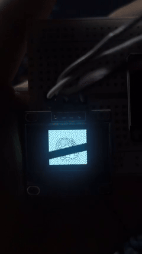

# Doro IoT Animation Display

Proyek IoT untuk menampilkan animasi karakter **Doro** dari game *GODDESS OF VICTORY: NIKKE* pada OLED monokrom 128×64 menggunakan ESP32.

Animasi diubah menjadi bitmap 1-bit agar dapat diputar frame demi frame langsung dari flash ESP32. README ini juga menyertakan video dokumentasi hasil pengujian perangkat.

## Demo perangkat



## Fitur

- Menampilkan animasi Doro pada OLED SSD1306 128×64.
- Memutar 8 frame bitmap dari `PROGMEM` sehingga RAM dinamis tetap hemat.
- Interval setiap frame: 130 ms, atau sekitar 7,7 FPS.
- Komunikasi OLED menggunakan I²C.
- Loop animasi berjalan terus-menerus tanpa input tambahan.

## Perangkat keras

| Komponen | Spesifikasi |
| --- | --- |
| Mikrokontroler | ESP32 DevKit atau board ESP32 yang kompatibel |
| Display | OLED SSD1306, 128×64, I²C |
| Tegangan logika | 3,3 V |
| Kabel | Jumper dan kabel USB untuk pemrograman/daya |

### Wiring

| OLED SSD1306 | ESP32 |
| --- | --- |
| VCC | 3V3 |
| GND | GND |
| SDA | GPIO 21 |
| SCL | GPIO 22 |

> Sketch menggunakan alamat I²C `0x3C`. Jika display tidak terdeteksi, pastikan alamat modul dan pin I²C sesuai dengan board yang dipakai.

## Perangkat lunak

1. Instal Arduino IDE atau PlatformIO.
2. Tambahkan dukungan board ESP32.
3. Instal library berikut dari Library Manager Arduino IDE:
   - `Adafruit GFX Library`
   - `Adafruit SSD1306`
4. Buka `doro/doro.ino`.
5. Pilih board ESP32 dan port serial yang benar.
6. Upload sketch ke board.

Sketch menginisialisasi I²C pada SDA `GPIO 21` dan SCL `GPIO 22`, lalu mengambil setiap pointer frame dari `bitmap_anim_frames`. Frame digambar ke buffer OLED dengan `drawBitmap()` dan ditampilkan memakai `display.display()`. Delay frame dibaca dari `bitmap_anim_delays` yang tersimpan di flash.

## Struktur repository

```text
Doro/
├── doro/
│   ├── anim.h       # 8 frame bitmap 128×64 dalam format MONO
│   └── doro.ino     # Sketch ESP32 + driver OLED SSD1306
├── docs/
│   ├── doro-display-demo.gif  # Preview animasi untuk README GitHub
│   └── doro-display-demo.mp4  # Video dokumentasi hasil pengujian
└── README.md
```

## Detail animasi

- Ukuran frame: `128 × 64` piksel.
- Format: bitmap monokrom horizontal.
- Jumlah frame: `8`.
- Ukuran tiap frame: `1024` byte.
- Total bitmap: sekitar `8 KB`.
- Delay: `130 ms` per frame.
- Perkiraan durasi satu putaran: `8 × 130 ms = 1,04 detik`.

Bitmap diletakkan di `PROGMEM` melalui deklarasi `PROGMEM` pada `anim.h`. Pendekatan ini menghindari pemakaian RAM untuk seluruh data frame dan sesuai untuk animasi statis berukuran kecil pada ESP32.

## Sumber aset dan atribusi

Frame animasi berasal dari GIF karakter Doro yang dibuat oleh creator **musanpro**, kemudian diubah menjadi bitmap monokrom untuk kebutuhan display OLED proyek ini. Hak cipta karakter dan aset asli tetap berada pada pemiliknya masing-masing; proyek ini adalah eksperimen personal IoT dan bukan produk resmi NIKKE.

Jika proyek ini dipublikasikan ulang, pertahankan atribusi kepada `musanpro` dan tambahkan tautan sumber GIF asli apabila URL sumber sudah tersedia.

## Troubleshooting

### OLED kosong

- Pastikan VCC dan GND tidak tertukar.
- Pastikan SDA berada di GPIO 21 dan SCL di GPIO 22.
- Pastikan alamat display `0x3C`; beberapa modul menggunakan `0x3D`.
- Pastikan library Adafruit GFX dan Adafruit SSD1306 sudah terinstal.

### Upload gagal

- Pilih board ESP32 yang benar.
- Pastikan port USB yang dipilih sesuai.
- Tekan tombol **BOOT** pada board ketika IDE meminta koneksi.

### Animasi terlalu cepat atau lambat

Ubah nilai pada array `bitmap_anim_delays` di `doro/anim.h`. Nilai lebih kecil membuat animasi lebih cepat, sedangkan nilai lebih besar membuatnya lebih lambat.

## Lisensi dan penggunaan

Kode sketch dan dokumentasi proyek ini disediakan untuk pembelajaran dan eksperimen pribadi. Jangan mengklaim GIF atau karakter Doro sebagai karya orisinal proyek ini. Periksa izin creator dan ketentuan aset game sebelum mendistribusikan ulang media atau membuat penggunaan komersial.
